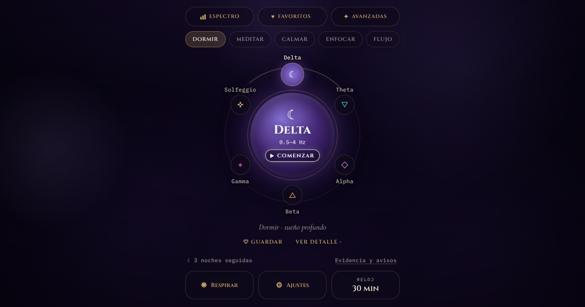
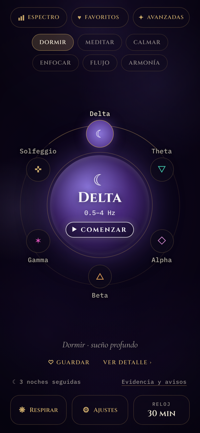
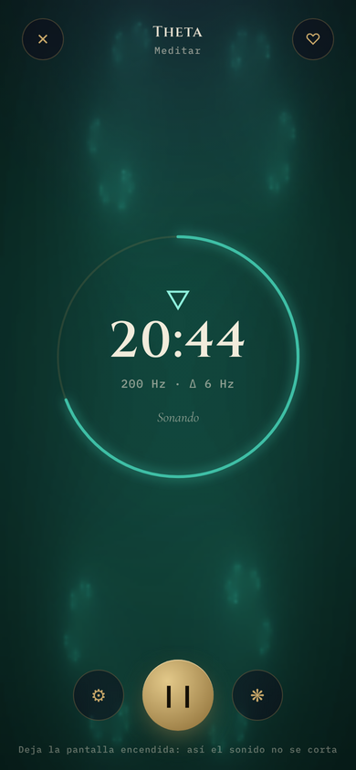
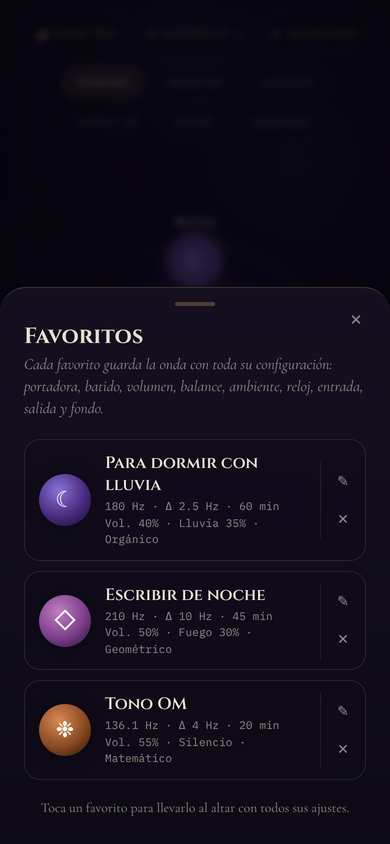
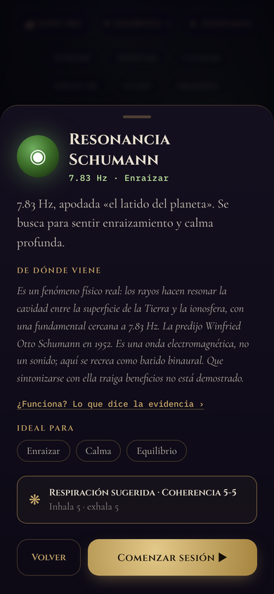
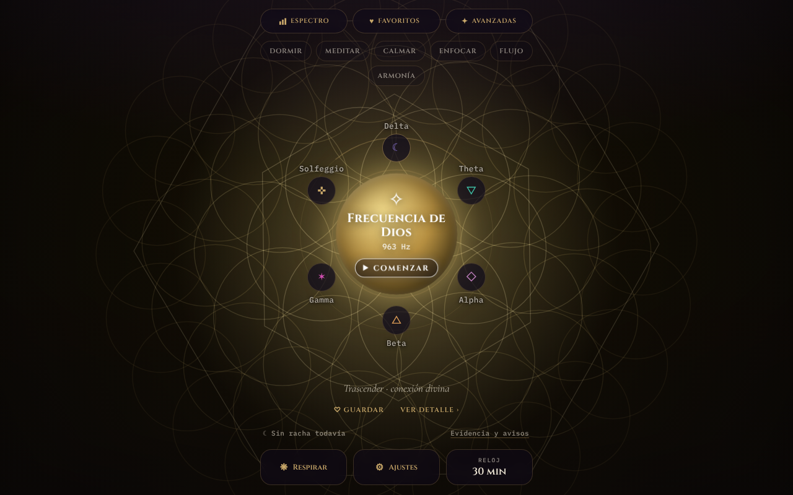

# Frecuencias binaurales

**[Español](#español) · [English](#english)**



---

## Español

> *Dos tonos, uno por oído, y el pulso que el cerebro pone entre ambos.*

**Frecuencias binaurales** genera tonos binaurales en el navegador para dormir, meditar, calmarse o enfocarse. Es un solo archivo HTML, sin dependencias, sin servidor y sin instalación: el sonido se sintetiza en el momento con la Web Audio API. Necesita audífonos.

Es bienestar sonoro, no un tratamiento. La aplicación dice qué se sabe de los tonos binaurales y qué no, y de dónde viene cada una de las frecuencias «sagradas» que ofrece.

### ▶ Abrir

`https://alex-vazquez73.github.io/frecuencias-binaurales/`

O abre `index.html` en cualquier navegador moderno.

### Qué tiene

- **Seis ondas en el altar:** Delta, Theta, Alpha, Beta, Gamma y Solfeggio (528 Hz), cada una con su portadora, su batido y su respiración sugerida.
- **Seis frecuencias avanzadas:** 963 Hz, resonancia Schumann (7.83 Hz), tono OM (136.1 Hz), 852 Hz, 741 Hz y 111 Hz.
- **Ajustes:** volumen, frecuencia portadora (60–1000 Hz), batido (0.5–40 Hz), balance, entrada y salida graduales.
- **Sonido ambiente:** lluvia, ruido rosa, olas y fuego, todos sintetizados; no hay archivos de audio.
- **Temporizador** de 10 a 90 minutos. Al terminar, el sonido se desvanece y se apaga solo.
- **Favoritos** que guardan la onda con toda su configuración.
- **Respiración guiada** (4-7-8, coherencia 5-5, caja 4-4-4-4 y otras).
- **Tres fondos animados:** orgánico, matemático (un conjunto de Julia) y geométrico.
- **Racha por noches:** una noche cuenta al escuchar al menos cinco minutos.
- **Pantalla oscurecida en sesión:** sigue encendida, casi negra, para que el navegador no corte el sonido.
- **Diseño adaptable** a teléfono, tableta y escritorio, en vertical y horizontal.

### Controles de teclado

| Tecla | Acción |
|---|---|
| `Espacio` o `K` | Pausar / reanudar la sesión |
| `Esc` | Cerrar la hoja o el aviso abiertos |
| `Tab` | Recorrer los controles |

### Cómo funciona el sonido

Un oscilador senoidal va al oído izquierdo a `portadora − batido/2` y otro al derecho a `portadora + batido/2`. Ninguno de los dos pulsa; el batido lo construye el cerebro al compararlos.

```
tonos ───┐
         ├─► envolvente (entrada/salida) ─► pausa ─► volumen ─► limitador ─► salida
ambiente ┘
```

Tres decisiones de diseño:

1. **El final de la sesión se programa en el reloj del audio**, no en un contador de JavaScript. Aunque el navegador frene los temporizadores de una pestaña en segundo plano, el sonido se desvanece y se apaga a su hora.
2. **Ninguna ganancia salta.** Pausar, reanudar y cambiar de ambiente anclan el valor actual antes de moverlo, así que no hay chasquidos.
3. **Los tonos agudos se atenúan.** A igual amplitud, 963 Hz se percibe mucho más fuerte que 180 Hz; la ganancia de los tonos se compensa según la portadora.

### Qué dice la evidencia

- El batido binaural lo describió Heinrich Wilhelm Dove en 1839. Solo se percibe con tonos por debajo de unos 1000 Hz (Licklider, 1950; Oster, 1973).
- Que el batido «arrastre» las ondas cerebrales es una hipótesis: una revisión sistemática de 14 estudios con EEG encontró cinco a favor, ocho en contra y uno mixto ([Ingendoh, Posny y Heine, 2023](https://pubmed.ncbi.nlm.nih.gov/37205669/)).
- Un metaanálisis de 22 estudios encontró un efecto de tamaño medio sobre ansiedad, memoria, atención y percepción del dolor ([García-Argibay, Santed y Reales, 2019](https://pubmed.ncbi.nlm.nih.gov/30073406/)).
- La serie Solfeggio no es medieval: la publicaron Puleo y Horowitz en 1999.

La lista completa de fuentes está dentro de la aplicación, en «Evidencia y avisos».

### Avisos

Volumen moderado. No la uses al conducir. Si tienes epilepsia o antecedentes de convulsiones, consulta antes a tu médico. En el teléfono, deja la pantalla encendida: muchos navegadores cortan el sonido al bloquearla.

### Privacidad

Todo ocurre en tu navegador. Los favoritos, la racha y los ajustes se guardan en `localStorage` y nunca salen de tu equipo. No hay cuentas, servidor ni rastreo.

### Tecnología

HTML, CSS y JavaScript sin frameworks, más la Web Audio API y Canvas. Un solo archivo de unos 280 KB, de los cuales 100 KB son código y el resto las tres tipografías incrustadas (Cinzel, Cormorant Garamond e IBM Plex Mono, bajo SIL Open Font License 1.1).

### Capturas

| El altar | En sesión | Favoritos | De dónde viene |
|---|---|---|---|
|  |  |  |  |



### Licencia

[MIT](LICENSE) © 2026 Alejandro Vázquez

---

## English

> *Two tones, one per ear, and the pulse the brain puts between them.*

**Frecuencias binaurales** generates binaural beats in the browser for sleep, meditation, calm or focus. It is a single HTML file: no dependencies, no server, no install. Sound is synthesized on the fly with the Web Audio API. Headphones are required. The interface is in Spanish.

It is sound for wellbeing, not a treatment. The app states what is and isn't known about binaural beats, and where each of its "sacred" frequencies comes from.

### ▶ Open

`https://alex-vazquez73.github.io/frecuencias-binaurales/`

Or open `index.html` in any modern browser.

### Features

- **Six waves on the altar:** Delta, Theta, Alpha, Beta, Gamma and Solfeggio (528 Hz), each with its carrier, beat and suggested breathing pattern.
- **Six advanced frequencies:** 963 Hz, Schumann resonance (7.83 Hz), OM tone (136.1 Hz), 852 Hz, 741 Hz and 111 Hz.
- **Settings:** volume, carrier frequency (60–1000 Hz), beat (0.5–40 Hz), balance, fade in and fade out.
- **Ambient sound:** rain, pink noise, waves and fire, all synthesized; there are no audio files.
- **Timer** from 10 to 90 minutes. When it ends, the sound fades out and stops by itself.
- **Favorites** that store a wave with its full configuration.
- **Guided breathing** (4-7-8, coherent 5-5, box 4-4-4-4 and others).
- **Three animated backgrounds:** organic, mathematical (a Julia set) and geometric.
- **Night streak:** a night counts after at least five minutes of listening.
- **Dimmed screen during a session:** it stays on, nearly black, so the browser doesn't cut the sound.
- **Responsive layout** for phone, tablet and desktop, portrait and landscape.

### Keyboard

| Key | Action |
|---|---|
| `Space` or `K` | Pause / resume the session |
| `Esc` | Close the open sheet or notice |
| `Tab` | Move through the controls |

### How the sound works

One sine oscillator goes to the left ear at `carrier − beat/2` and another to the right ear at `carrier + beat/2`. Neither one pulses; the beat is built by the brain when it compares them.

```
tones ───┐
         ├─► envelope (fade in/out) ─► pause ─► volume ─► limiter ─► output
ambient ─┘
```

Three design decisions:

1. **The end of the session is scheduled on the audio clock**, not on a JavaScript counter. Even if the browser throttles timers in a background tab, the sound fades and stops on time.
2. **No gain ever jumps.** Pause, resume and ambient changes anchor the current value before moving it, so there are no clicks.
3. **High tones are attenuated.** At equal amplitude, 963 Hz is perceived as far louder than 180 Hz; tone gain is compensated by carrier frequency.

### What the evidence says

- The binaural beat was described by Heinrich Wilhelm Dove in 1839. It is only perceived with tones below roughly 1000 Hz (Licklider, 1950; Oster, 1973).
- That the beat "entrains" brainwaves is a hypothesis: a systematic review of 14 EEG studies found five in favor, eight against and one mixed ([Ingendoh, Posny & Heine, 2023](https://pubmed.ncbi.nlm.nih.gov/37205669/)).
- A meta-analysis of 22 studies found a medium-sized effect on anxiety, memory, attention and pain perception ([García-Argibay, Santed & Reales, 2019](https://pubmed.ncbi.nlm.nih.gov/30073406/)).
- The Solfeggio series is not medieval: it was published by Puleo and Horowitz in 1999.

The full source list is inside the app, under "Evidencia y avisos".

### Cautions

Keep the volume moderate. Do not use it while driving. If you have epilepsy or a history of seizures, talk to your doctor first. On a phone, keep the screen on: many browsers cut the sound when it locks.

### Privacy

Everything happens in your browser. Favorites, the streak and settings are stored in `localStorage` and never leave your device. No accounts, no server, no tracking.

### Tech

HTML, CSS and JavaScript with no frameworks, plus the Web Audio API and Canvas. A single file of about 280 KB: 100 KB of code and the rest three embedded typefaces (Cinzel, Cormorant Garamond and IBM Plex Mono, under the SIL Open Font License 1.1).

### License

[MIT](LICENSE) © 2026 Alejandro Vázquez
